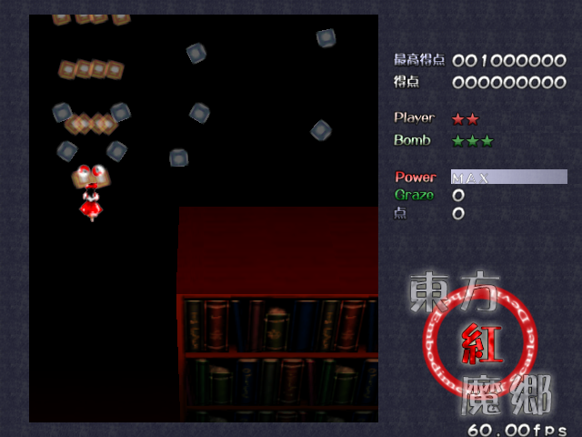

# th06-arm64



**東方紅魔郷 ～ the Embodiment of Scarlet Devil** — portable build reworked for **Linux ARM64 (aarch64)**.

I wanted to play Touhou 6 on my **Raspberry Pi 5**, so I took the EoSD-portable source and
reworked it into a native Linux ARM64 target — this repository is that build. The rendering,
input, audio and file-system layers sit on top of SDL2, so the game runs on the Pi 5 and other
ARM64 Linux boards, SBCs, ARM laptops and ARM64 virtual machines instead of relying on a
Windows/x86 environment.

The screenshot above is the game running natively on a Raspberry Pi 5 at
60 fps (attract-mode demo, Stage 4).

It is derived from the [th06 decompilation project](https://github.com/GensokyoClub/th06)
and keeps the original Japanese data formats, so it acts as a drop-in replacement binary for
the vanilla game once your data files are in place.

## What changed for ARM64

- Dedicated `Makefile` cross-compiling with `aarch64-linux-gnu-g++` into `build-arm64/`.
- Little-endian aarch64 code paths, including the unaligned-access fallbacks in `ZunEndian.hpp`.
- SDL2 + OpenGL/GLES renderer backends (fixed-function GL, software and WebGL paths) used on Linux.
- ALSA MIDI output on Linux, with a `--no-asoundlib` build option to drop the dependency.
- No Japanese locale required; filenames are still the original Shift-JIS Japanese names.

## Requirements

| Component | Requirement |
| --- | --- |
| Architecture | `aarch64` / ARM64, little endian |
| Compiler | C++20 capable GCC or Clang |
| Libraries | SDL2, SDL2_image, SDL2_ttf, libasound (MIDI, optional) |
| Graphics | OpenGL ES 1.1/2.0, OpenGL 1.3 or GL 2.1 |
| Game data | Original Touhou 6 data files (`紅魔郷CM.DAT`, etc.) |
| Font | `msgothic.ttc`, or `NotoSansJP-Regular.ttf` as fallback |

## Building

### Native build on ARM64 Linux

```sh
sudo apt install build-essential libsdl2-dev libsdl2-image-dev libsdl2-ttf-dev libasound2-dev
make -j$(nproc)
```

The resulting binary is `./th06`.

### Cross-compiling from x86_64

```sh
sudo apt install g++-aarch64-linux-gnu \
    libsdl2-dev:arm64 libsdl2-image-dev:arm64 libsdl2-ttf-dev:arm64 libasound2-dev:arm64

make -j$(nproc)
```

`make` uses `aarch64-linux-gnu-g++` and writes objects to `build-arm64/`.
Run `make clean` to remove the build output and the binary.

### Using premake5 (optional)

The upstream premake build is still available:

```sh
premake5 gmake
cd build && make -j$(nproc)
```

Options: `--no-asoundlib` (build without ALSA MIDI), `--use-c23-embed` (use `#embed` for resources).

## Running

Prebuilt binaries are available on the [Releases](https://github.com/Anti-Anti-Anit/th06-arm64/releases) page.

1. Copy the ARM64 `th06` binary into your game directory with the original data files.
2. Provide a Japanese font: place `msgothic.ttc` in the game directory, or copy
   `NotoSans-Regular.ttf` to `NotoSansJP-Regular.ttf` to use the bundled fallback.
3. Launch `./th06`.

The game reads the original Japanese filenames (for example `紅魔郷CM.DAT` and `東方紅魔郷.cfg`).
English translation patches and thcrap are not supported.

### Music

Two BGM modes are supported (Music Mode in the game options):

- **WAV** — `bgm/th06_*.wav` streamed through SDL audio. This is the
  recommended mode; with WAV tracks present it is selected automatically.
- **MIDI** — `bgm/th06_*.mid` through the ALSA sequencer (`TH06 MIDI Out`),
  which connects to the first hardware or software synth it finds. A bare Pi
  has no synth, so install one:

  ```sh
  sudo apt install fluidsynth fluid-soundfont-gm
  fluidsynth -a alsa -m alsa_seq -g 0.5 /usr/share/sounds/sf2/FluidR3_GM.sf2 &
  ```

#### No sound on Raspberry Pi 5? (common fix)

The Pi 5 has **no headphone jack** — audio goes out through HDMI only. If the
game is silent even with WAV BGM, check the audio stack before blaming the
game:

```sh
systemctl --user status pipewire wireplumber   # both must be active
wpctl get-volume @DEFAULT_AUDIO_SINK@          # e.g. 0.16 = nearly silent!
systemctl --user enable --now pipewire wireplumber
wpctl set-volume @DEFAULT_AUDIO_SINK@ 1.0
```

Also verify your monitor actually exposes speakers
(`cat /proc/asound/card0/eld*`), and note that MIDI-only USB gadgets can
appear as sound cards and confuse routing. A standalone SDL sine probe is
included at `tools/sdl_sine.cpp` to test the output path independently of
the game.

## Repository layout

```
src/                 game logic, renderer, audio, archive parsers
src/graphics/        fixed-function GL, software and WebGL backends
src/midi/            ALSA, CoreAudio and Win32 MIDI backends
src/pbg3/            PBG3 archive reader used by the game data files
tools/               helper scripts (resource embedding)
Makefile             ARM64 cross-compilation build
premake5.lua         upstream premake build definition
```

## License

Licensed under the **GNU General Public License v3.0** — see [LICENSE](LICENSE).

## Credits

- [GensokyoClub/th06](https://github.com/GensokyoClub/th06) — the EoSD decompilation project
  and its contributors.
- The EoSD-portable authors, whose SDL2 portability layer this fork builds on.
- [SDL2](https://www.libsdl.org/), SDL2_image and SDL2_ttf.
- All original Touhou Project assets and characters belong to Team Shanghai Alice / ZUN.
  This project ships no game data.
